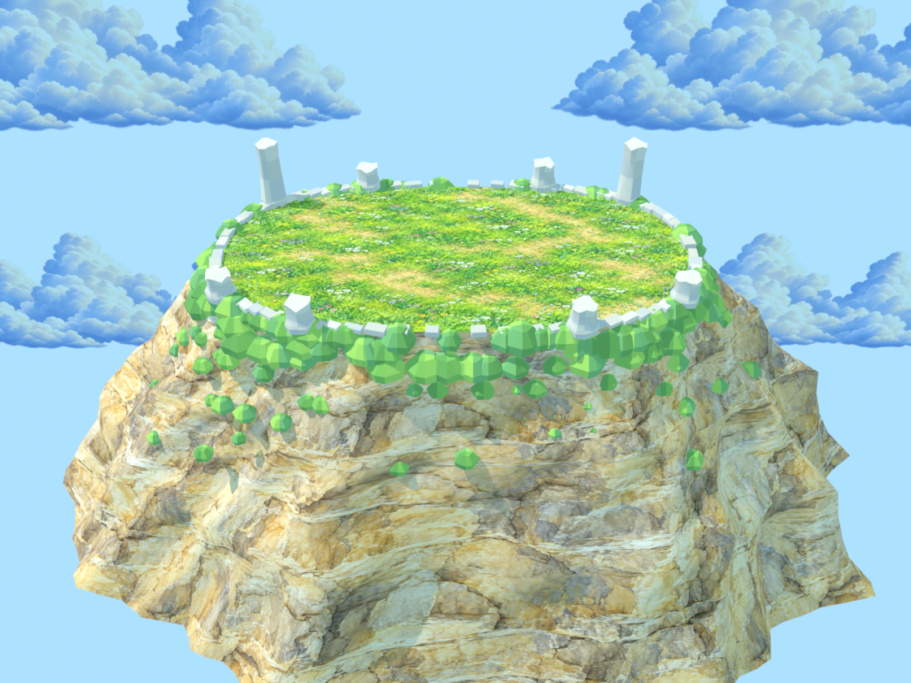

# Out-Mathed

**Draw a fighter. Choose an equation. Try to stay on the mountain.**



Out-Mathed is a browser game with two ways to play. **Projectile Duel** is a turn-based 3-vs-3 match where your equation becomes a shot. **Bump Duel** is a simultaneous launch: everyone secretly chooses a path, then their drawn fighters collide on a shrinking summit. You can draw a character first or jump in with starter characters.

## Play in a minute

1. On the [home page](index.html), choose **Projectile Duel** or **Bump Duel**. The smaller “Play with starter characters” link skips drawing.
2. If you draw, you have **20 L of ink** and a **10-second timer that starts with your first mark**. Repainting the same area does not spend more ink. Press **Enter** to finish early.
3. In the arena, enter an equation and inspect its preview before committing. The game uses the previewed path for the actual shot or launch.

| Mode | What you control | How to win |
| --- | --- | --- |
| **Projectile Duel** | Pick one of your three teammates, plot a curve, set Force, and fire. Play against a local player or AI. | Knock out the other team's fighters. |
| **Bump Duel** | Plot a path and set Force. Everyone locks a choice before the launch. | Be the last fighter on the summit. |

Projectile Duel accepts explicit `y = f(x)`, parametric `x(t), y(t)`, polar `r(θ)`, and implicit `F(x,y) = 0` curves. Bump Duel uses an explicit expression such as `0`, `0.5*x`, or `sin(x)`. Type the expression in the field; the UI supplies the equation label. The editor uses **MathLive**, with a plain-text fallback if it cannot load. The game evaluates expressions with its own parser; it does not use the Desmos API.

**Bump Duel with friends:** Quick Match pairs you with another player or adds a bot after about 10 seconds. For a private 1-vs-1 match, copy the invite link. **Group room (2–4)** lets the host invite up to three friends and start once at least two players have joined. Online rooms need the Node/WebSocket server. If a hosted Quick Match cannot reach it, a browser bot is available; private and group rooms need a live server.

**Choose an AI:** Both arenas have separate **AI Type** and **Difficulty** selectors.
Normal compares several equation families; Parametric, Polar (circles/cardioids),
Absolute, Trig, and Rational specialize in their named curves. Easy tries one
approximate choice, Medium compares a few, and Hard simulates more choices with
the same physics. Selected Bump AI runs in the browser, independently of the
multiplayer server, and never reads your hidden path. The existing online
Quick Match bot and human/group rooms keep their current rules.

**Projectile branch abilities:** Rational branches launch together, sharing one
recoil and one hit per enemy. Other disconnected paths teleport between branch
starts without damaging anything in the gap. **Dot AI** and the player's
**Discrete dots** input use isolated points with speed-based timing between them.
Solid travel and arrival points still check walls and the map edge. Dot AI is
not available in Bump Duel; Bump characters follow only their continuous launch
branch. Changing AI settings starts a fresh match and cancels pending choices.

## How the drawing affects play

The creator saves your drawing in this tab's `sessionStorage`, so continue to the arena in the **same tab**. The visible shape comes from a 128×80 occupancy mask. More filled cells mean more mass; cells farther from the centre add rotational inertia. The same mask supplies Bump Duel's visible body and contact outline.

Both modes use **change in velocity = impulse ÷ mass**. A heavy fighter changes speed less than a light fighter receiving the same collision impulse. In Bump Duel, the collision solver applies equal and opposite impulses to both fighters; an off-centre contact can also spin them, with the spin depending on each drawing's inertia. Heavier fighters start a Bump launch slower and travel a shorter path for the same Force. In Projectile Duel, the shooter's mass affects recoil and the target's mass affects knockback; damage is a separate fixed rule. These are game physics with tuned launch and bounce values, not a full material simulation.

## Run it locally

Use **Node.js 22.9 or newer**:

```sh
npm install
npm start
```

Open the address printed by the server (normally `http://127.0.0.1:5173`). For another device on your network, start with `HOST=0.0.0.0 npm start` and open the host computer's network address on both devices. `localhost` on a second device points back to that device. Restart an old server after pulling new backend code. Local development watches source files and reloads the page; backend changes restart the server and clear local rooms.

```sh
npm test
npm run build
```

`npm run build` writes a static site to `dist/`. It includes the pages, assets, and browser libraries. **A static host cannot run multiplayer rooms by itself.** If the website and WebSocket server are on different hosts, set `BUMP_SERVER_URL` to the server's HTTPS or WSS address when building. A single Node deployment can use the same host without that setting.

## Where to look in the code

| If you want to understand… | Start here |
| --- | --- |
| The homepage and drawing controls | [`index.html`](index.html), [`create.js`](create.js), [`src/character-geometry.js`](src/character-geometry.js) |
| Equation parsing and the previewed curve | [`src/equations.js`](src/equations.js), [`src/curves.js`](src/curves.js), [`src/math-text.js`](src/math-text.js) |
| Projectile hits, recoil, and turns | [`src/projectile.js`](src/projectile.js), [`src/combat.js`](src/combat.js), [`src/main.js`](src/main.js) |
| Bump launches, mass, contact, and spin | [`src/duel.js`](src/duel.js), [`src/body.js`](src/body.js), [`src/physics.js`](src/physics.js) |
| 3D arena and fighter rendering | [`src/scene.js`](src/scene.js), [`src/mountain.js`](src/mountain.js) |
| Online rooms and browser connection | [`server.js`](server.js), [`src/duel-client.js`](src/duel-client.js) |
| Build and verification | [`build.js`](build.js), [`tests/`](tests/) |

The simulation advances in fixed steps (`src/physics.js`), so browser frame rate does not decide the collision outcome. The Bump server runs the authoritative simulation for online rooms and sends state to clients. The editable mountain is [`assets/mountain.blend`](assets/mountain.blend); [`tools/build_mountain.py`](tools/build_mountain.py) exports the browser model.

## Optional analytics

Analytics are disabled unless `POSTHOG_PROJECT_TOKEN` and `POSTHOG_HOST` are set. For local work, put them in an ignored `.env` file. Set the same variables in the deployment environment and rebuild the static site. Use a **public project token**, never a personal API key. Events describe page and game actions, not drawings, typed equations, or room/reconnect tokens.

Live game: [math-knockout-2.onrender.com](https://math-knockout-2.onrender.com/)
